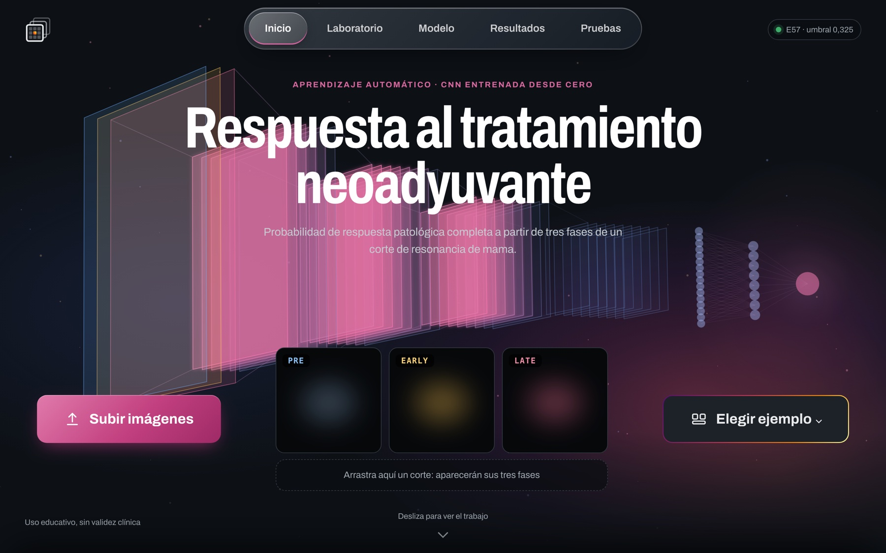

# Predicción de pCR con DCE-MRI y una CNN 2D desde cero

[](https://rubenelices-pcr-demo.hf.space)

**Demo web:** [rubenelices-pcr-demo.hf.space](https://rubenelices-pcr-demo.hf.space) · **Pesos del modelo:** [huggingface.co/RubenElices/BreastDCEDL](https://huggingface.co/RubenElices/BreastDCEDL) · **Resultados:** [research/RESULTADOS.ipynb](research/RESULTADOS.ipynb) · **Presentación:** [docs/presentation](docs/presentation/presentacion.pdf)

Proyecto de Aprendizaje Automático (Universidad Alfonso X el Sabio, 2026–2027). Estima la probabilidad de **respuesta patológica completa (pCR)** a la quimioterapia neoadyuvante en cáncer de mama a partir de las tres fases de una resonancia con contraste (DCE-MRI) previa al tratamiento. El modelo es una CNN 2D diseñada y entrenada desde cero en PyTorch, sin transfer learning, sin pesos preentrenados y sin arquitecturas importadas.

> **Uso educativo, sin validez clínica.** La probabilidad no es un diagnóstico, ni supervivencia, ni una recomendación terapéutica.

## Índice

1. [Resumen](#resumen)
2. [El problema y los datos](#el-problema-y-los-datos)
3. [Preprocesado](#preprocesado)
4. [Protocolo experimental](#protocolo-experimental)
5. [El modelo entregado: E57](#el-modelo-entregado-e57)
6. [Recorrido del trabajo](#recorrido-del-trabajo)
7. [Resultados](#resultados)
8. [Conclusiones y limitaciones](#conclusiones-y-limitaciones)
9. [La web](#la-web)
10. [Cómo usar la web](#cómo-usar-la-web)
11. [Reproducir el trabajo](#reproducir-el-trabajo)
12. [Estructura del repositorio](#estructura-del-repositorio)
13. [Datos y licencia](#datos-y-licencia)

## Resumen

| | |
|---|---|
| **Modelo entregado** | E57: CNN 2D propia de 298.161 parámetros |
| **Entrada** | Un corte `[3, 256, 256]` con las fases PRE, EARLY y LATE (tiempos de adquisición, no colores RGB) |
| **Salida** | Probabilidad de pCR por corte; la de una paciente es la media de sus cortes |
| **Umbral** | 0,325, fijado en validación antes de abrir el test |
| **Test público** | AUC por paciente **0,573** [IC95 0,475–0,671], evaluado una sola vez |
| **Validación cruzada de la receta** | AUC 0,507 en 1.097 pacientes (predicciones fuera de fold) |
| **Línea base** | Saber solo la cohorte de la paciente: AUC 0,523 |

El trabajo tuvo tres etapas. Primero, una búsqueda amplia de casi 200 experimentos de arquitectura y regularización, de la que salió E57. Segundo, un diagnóstico que explicó por qué esas comparaciones no distinguían nada: con la receta de entrenamiento original la red apenas aprendía. Tercero, una serie de hipótesis con criterios escritos antes de ejecutar (P01–P07, N01) para corregir la receta y medir con honestidad cuánta señal hay en la imagen.

La conclusión principal es que la red **sí puede aprender** cuando se corrige la receta, pero lo que aprende de las imágenes **no supera de forma demostrable** a saber de qué cohorte procede la paciente. Todo está documentado, incluidos los resultados negativos.

## El problema y los datos

**BreastDCEDL** reúne resonancias de mama con contraste de tres cohortes: **Duke**, **I-SPY1** e **I-SPY2**.

| Conjunto | Pacientes | pCR | Cortes |
|---|---:|---:|---:|
| Entrenamiento público | 1.097 | 322 (29,3 %) | 10.945 |
| Test público | 176 | 53 | 1.758 |
| Validación privada | solo profesorado | — | — |

- De cada paciente hay unos **10 cortes** axiales, muy correlacionados entre sí.
- Cada corte tiene **tres fases**: **PRE** (antes del contraste), **EARLY** (realce temprano) y **LATE** (realce tardío). Cada fase es un PNG de 256 × 256 en escala de grises.
- El objetivo es binario: **pCR = 1** (no queda tumor invasivo tras la quimioterapia) frente a **pCR = 0**. Es una predicción de la respuesta futura, no la detección de un tumor.
- Las cohortes tienen prevalencias y criterios de selección de cortes distintos. Por eso la cohorte sola ya da un AUC de ≈ 0,52–0,55, y cualquier resultado se compara con esa línea base.
- La **unidad estadística es la paciente**. Los cortes de una paciente no son observaciones independientes.

## Preprocesado

El preprocesado es el mismo, con el mismo código, en entrenamiento, evaluación y web ([src/pipeline/](src/pipeline/)):

1. Se leen los tres PNG del corte en escala de grises.
2. Se dividen entre 255 y se apilan en un tensor `float32` de forma `[3, 256, 256]`, en el orden PRE, EARLY, LATE.
3. Nada más. No hay normalización ImageNet ni aumentos de color o de brillo, porque las intensidades relativas entre fases son la información del realce.

Dentro de la red, la primera operación es fija y sin pesos: convierte la entrada en **PRE, EARLY − PRE y LATE − EARLY**. Así, los canales que llegan a las convoluciones representan directamente la llegada y la salida del contraste.

Cuando se usan aumentos geométricos (P02), las tres fases reciben **exactamente la misma transformación**: un solo sorteo de espejo, giro y desplazamiento por corte. Si cada fase se moviera por su cuenta, el realce EARLY − PRE se falsearía.

## Protocolo experimental

- **Particiones agrupadas por paciente.** Se usan los 5 folds del profesorado. Los cortes de una paciente nunca se reparten entre conjuntos.
- **Tres conjuntos en cada fold** (protocolo N01):
  - **FIT** (≈ 80 % del resto del fold): actualiza los pesos y las estadísticas de BatchNorm.
  - **Validación interna** (≈ 20 %, estratificada por pCR, semilla 42): elige la época y el umbral.
  - **Fold exterior** (≈ 219 pacientes): se evalúa una vez con la época y el umbral ya fijados.
- **El test público no se usa para elegir nada**: ni arquitectura, ni hiperparámetros, ni umbral, ni calibración, ni épocas, ni agregación. El de E57 se evaluó una sola vez.
- **Pérdidas comparadas:** `BCEWithLogitsLoss` normal y ponderada con `pos_weight = N0/N1`, contando pacientes de FIT.
- **Criterios antes de ejecutar.** Cada experimento nuevo tiene una hipótesis, **una sola variable cambiada** y criterios de éxito escritos y fechados antes de entrenar. Las desviaciones se anotan.
- **Incertidumbre.** Con ≈ 219 pacientes el error típico del AUC es ≈ 0,043, así que no se declara ganador con un fold. Las comparaciones entre recetas usan **bootstrap pareado** sobre las mismas pacientes (2.000 réplicas, estratificado por fold × cohorte × clase).
- **Métricas** por paciente (principal) y por corte (la demo evalúa un corte), además de AP, Brier, matriz de confusión y AUC por cohorte.

## El modelo entregado: E57


| Bloque | Operaciones | Salida |
|---|---|---|
| Representación temporal | PRE · EARLY − PRE · LATE − EARLY (fija, sin pesos) | 3 × 256 × 256 |
| Bloque 1 | Conv 3×3 (16) · BN · ReLU · MaxPool · Conv 3×3 (16) · BN · ReLU | 16 × 128 × 128 |
| Bloque 2 | Conv (32) · BN · ReLU · MaxPool · Conv (32) · BN · ReLU | 32 × 64 × 64 |
| Bloque 3 | Conv (64) · BN · ReLU · MaxPool · Conv (64) · BN · ReLU | 64 × 32 × 32 |
| Bloque 4 | Conv (128) · BN · ReLU · MaxPool · Conv (128) · BN · ReLU | 128 × 16 × 16 |
| Media espacial global | Promedio de cada mapa | 128 |
| Cabeza | Linear 128→32 · ReLU · Dropout 0,3 · Linear 32→1 | 1 logit |

- **Parámetros:** 298.161 (extractor 294.000 y cabeza 4.161). Todas las convoluciones son 3×3 con padding 1 y stride 1.
- **Campo receptivo** convolucional final: 106 × 106 píxeles. Es un cálculo geométrico; no dice qué regiones usa el modelo.
- **Entrenamiento original:** lotes de 2 pacientes con todos sus cortes. La red promedia las características de los cortes de cada paciente y aplica la cabeza (pérdida por paciente). Usa BCE normal, AdamW (LR 0,001, weight decay 0,001), ReduceLROnPlateau por AUC de paciente, paciencia 10 y semilla 42.
- **Evaluación:** se predice cada corte, se aplica la sigmoide y se promedian las probabilidades de cada paciente.
- **Checkpoint entregado:** fold 0, época 14 (AUC de validación 0,670). El umbral 0,325 se eligió en esa validación.
- **Protocolo congelado** en [model/protocolo_e57.json](model/protocolo_e57.json): umbral, agregación y SHA-256 de los pesos. El servidor se niega a cargar unos pesos cuyo SHA no coincida.

La ficha completa, con todas las capas y el diagrama de volúmenes, está en [experiments/E57_patient_feature_mean_mac/](experiments/E57_patient_feature_mean_mac/README.md).

## Recorrido del trabajo

### 1. Búsqueda inicial: casi 200 experimentos

Se probaron arquitecturas (A01–A06: una o dos convoluciones por bloque, cinco bloques, la mitad de canales…), regularización (dropout, spatial dropout, weight decay), tasas de aprendizaje, aumentos geométricos y de ganancia, diferencias de fase, GroupNorm, un corte por paciente, mixup, label smoothing, pérdida ponderada y, como control, modelos con datos clínicos. Hay una línea por ejecución en [research/HISTORIAL_EXPERIMENTOS.md](research/HISTORIAL_EXPERIMENTOS.md).

- En modelos solo de imagen, el AUC máximo de validación tuvo una mediana de 0,591 (rango 0,503–0,670).
- E57 dio el pico más alto (0,670 en el fold 0) y una media de los cinco máximos de 0,622. Esas cifras eligen la época mirando la propia validación, así que son **optimistas**.
- Los modelos con clínica (edad, menopausia, subtipo) no son comparables con los de solo imagen. El modelo entregado usa **solo imágenes**.

### 2. Diagnóstico: la red no aprendía

Al revisar las curvas completas de E57 se vio el problema:

- La pérdida de entrenamiento se quedaba en **0,59–0,63**. La de un predictor constante que siempre responde la prevalencia es **0,605**.
- Las probabilidades por paciente apenas variaban (desviación típica 0,02–0,07).
- El AUC en FIT-eval rondaba 0,50–0,56.
- Los picos de validación cabían en el ruido de 219 pacientes más la elección de la mejor época.

Por eso los ~200 experimentos no distinguían arquitecturas: las diferencias de 0,01–0,04 estaban dentro del ruido.

**Hipótesis:** con lotes de solo 2 pacientes, BatchNorm normaliza cada canal con las estadísticas de esas dos. La media de ambas queda forzada a compensarse, y en el ~59 % de los lotes las dos tienen la misma etiqueta: no hay nada que discriminar. Además, en `eval()` se usan estadísticas acumuladas distintas de las de entrenamiento.

### 3. P01: lotes de 10 pacientes × 2 cortes

Única variable cambiada: el lote. Se mantienen ~20 imágenes por paso, pero ahora de 10 pacientes, con 2 cortes al azar de cada una ([research/P01_LOTES.md](research/P01_LOTES.md)).

- **Prueba de memorización con 40 pacientes:** P01 supera un AUC de 0,90 en 3 épocas (1,0 en la cuarta); la receta de E57 necesita 23, y su pérdida de entrenamiento sigue en 0,54–0,61 al final. La receta explicaba el colapso.
- **Fold 0 completo:** la red ya aprende (FIT-eval de 0,47 a 0,94), pero **memoriza**. La validación interna se queda plana en 0,50–0,61 y su BCE sube desde la época 3. Exterior: 0,570.

### 4. P02: P01 + aumento geométrico sincronizado

Única palanca de regularización, decidida antes: espejos horizontal y vertical (p = 0,5), giro de ±10° y traslación de ±3 %, idénticos en las tres fases ([research/P02_AUMENTO.md](research/P02_AUMENTO.md)).

- **Frena la memorización:** la diferencia FIT − interna en la última época pasa de 0,37 a 0,14, y la BCE interna se mantiene estable.
- **No mejora la generalización:** interna máxima 0,625 y exterior 0,535 en el fold 0.
- Según la regla fijada, se cierra la búsqueda de recetas, y la comparación obligatoria normal/ponderada se hace con P02 en los 5 folds.

### 5. Validación cruzada de 5 folds: normal frente a ponderada

| Receta (5 folds, 1.097 pacientes) | AUC exterior conjunta | IC95 |
|---|---:|---|
| P02 · BCE normal | **0,532** | 0,493–0,570 |
| P02 · BCE ponderada (`pos_weight = N0/N1`) | 0,500 | 0,464–0,535 |
| Línea base de cohorte | 0,523 | — |

- Normal − ponderada = +0,032 [−0,001, +0,064]: **sin diferencia demostrada**. La ponderada concentra las probabilidades cerca de 0,5 y empeora la calibración.
- Por cohorte, P02 normal da 0,61 en I-SPY1, 0,54 en I-SPY2 y 0,40 en Duke, donde ordena al revés.

### 6. Hipótesis descartadas con criterios previos

Antes de gastar entrenamientos, cada idea pasó un "paso 0" barato con su criterio fijado:

| Hipótesis | Resultado | Decisión |
|---|---|---|
| **P03** · recorte central (quitar periferia) | El realce solo se conserva con recorte de 192, y E57 no se apoya en la periferia | Descartada ([P03](research/P03_PASO0.md)) |
| **P04** · realce relativo (PE/SER) como señal | Cohorte + PE/SER − cohorte = +0,014 [−0,012, +0,039] | Descartada ([P04](research/P04_PASO0B.md)) |
| **P05** · tasa de aprendizaje 0,0001 | Ya probada en E12 y E55 sin mejora | Retirada sin ejecutar ([P05](research/P05_LR_BAJO.md)) |
| **P06** · centrarse en la región que más realza | +0,009 [−0,019, +0,038] sobre la cohorte | Descartada ([P06](research/P06_PASO0C.md)) |
| **P07** · ensemble de 3 semillas de P02 | 0,543; − cohorte = +0,021 [−0,014, +0,054] | Descartada ([P07](research/P07_SEMILLAS.md)) |
| **N01** · validación cruzada de la receta de E57 | 0,507; − cohorte = −0,015 [−0,037, +0,006] | No supera a la cohorte ([N01](research/N01_CV.md)) |

N01 era la prueba más directa del modelo entregado. Su fold 0 había dado 0,617, la cifra exterior más alta del proyecto, pero fue el mejor de cinco: el resto quedó entre 0,445 y 0,542.

### 7. Decisión de entrega

Las reglas se escribieron y se registraron con su SHA-256 antes de ver los resultados de la validación cruzada ([research/REGLAS_ENTREGA.md](research/REGLAS_ENTREGA.md)). P02 solo sustituiría a E57 si su AUC conjunta llegaba a 0,55. Como se quedó en 0,532, **se mantiene E57**, cuyo test ya estaba evaluado. No se ha evaluado ningún otro candidato en test.

## Resultados

### Test público de E57 (evaluado una sola vez)

| Unidad | N | ROC-AUC | AP | Brier |
|---|---:|---:|---:|---:|
| Paciente (principal) | 176 pacientes | **0,573** [0,475–0,671] | 0,421 | 0,212 |
| Corte (secundaria) | 1.758 cortes | 0,567 | 0,393 | 0,212 |

El intervalo sale de 2.000 remuestreos por paciente.

Con el umbral 0,325:

| | Predicho no pCR | Predicho pCR |
|---|---:|---:|
| **Real no pCR** | 92 (VN) | 31 (FP) |
| **Real pCR** | 35 (FN) | 18 (VP) |

Sensibilidad 34,0 %, especificidad 74,8 % y precisión 36,7 %. El intervalo del AUC incluye 0,5.

### Resumen de las cifras honestas

| Evaluación | AUC por paciente |
|---|---:|
| E57, test público | 0,573 |
| Receta de E57 (N01), 5 folds fuera de fold | 0,507 |
| P02 normal, 5 folds | 0,532 |
| P02 ponderada, 5 folds | 0,500 |
| Ensemble de 3 semillas (P07), 5 folds | 0,543 |
| Solo la cohorte | 0,523 |

Las curvas completas (pérdida y AUC por época en FIT-eval, validación interna y exterior, por paciente y por corte), las matrices de confusión, las ROC y PR y el desglose por cohorte y por fold están en [research/RESULTADOS.ipynb](research/RESULTADOS.ipynb).

## Conclusiones y limitaciones

- **La receta de entrenamiento importaba más que la arquitectura.** Con lotes de 2 pacientes, BatchNorm impedía aprender; con 10, la red aprende. Una búsqueda de arquitecturas sobre una receta que no aprende no puede distinguir arquitecturas.
- **Aprender no es generalizar.** Con la receta corregida la red memoriza el entrenamiento, y el aumento geométrico frena esa memorización sin mejorar el AUC en pacientes nuevas.
- **La señal de imagen que generaliza es pequeña.** Con estos datos, cortes 2D y una CNN desde cero, ningún modelo supera de forma demostrable a la línea base de cohorte. El 0,573 del test de E57 es compatible con esa conclusión, porque su intervalo incluye 0,5.
- **BCE normal frente a ponderada:** sin diferencia demostrada en AUC, aunque la ponderada empeora la calibración.
- **Limitaciones:**
  - Los folds exteriores se observaron durante la historia del proyecto, así que no equivalen a un test nuevo.
  - E57 salió de muchos experimentos de desarrollo.
  - No se ha estudiado la estabilidad del checkpoint entregado con otras semillas.
  - Los mapas de oclusión muestran sensibilidad de la salida, no causalidad.
  - El umbral 0,325 se eligió por paciente; aplicarlo a un solo corte en la web es una convención.

## La web

La web presenta el trabajo y permite usar el modelo entregado con cualquier corte.

- **Interfaz:** React + Vite ([frontend/](frontend/)).
- **Servidor:** Flask ([app.py](app.py)). Sirve la interfaz compilada y la API de inferencia (`/api/predict`, `/api/laboratorio`, `/api/occlusion`, `/api/modelo`).
- **Inferencia:** usa el mismo cargador y preprocesado que el entrenamiento ([src/web/](src/web/)). Se comprobó que la web y el pipeline científico dan la misma probabilidad para el mismo corte.
- **Pesos:** se descargan de [Hugging Face](https://huggingface.co/RubenElices/BreastDCEDL) al arrancar y se verifica su SHA-256.
- **Privacidad:** el servidor no guarda las imágenes recibidas.
- **Despliegue:** en un [Hugging Face Space](https://rubenelices-pcr-demo.hf.space) gratuito, en CPU. Los detalles están en [deploy/README.md](deploy/README.md).

## Cómo usar la web

Abre [rubenelices-pcr-demo.hf.space](https://rubenelices-pcr-demo.hf.space). Si el Space llevaba un rato sin uso, la primera carga tarda unos segundos en despertarlo. Arriba a la derecha, el indicador verde **E57 · umbral 0,325** confirma que el modelo está cargado.

### Formato de las imágenes

Cada corte son **tres PNG** de 256 × 256 en escala de grises, uno por fase. El nombre debe **terminar en `_PRE.png`, `_EARLY.png` y `_LATE.png`**, con la misma parte inicial en los tres. Es el formato del propio dataset:

```
ISPY1_1114_z014_PRE.png
ISPY1_1114_z014_EARLY.png
ISPY1_1114_z014_LATE.png
```

La web agrupa las fases por ese nombre común y comprueba cada corte: que estén las tres fases, el tamaño y la escala de grises. Si algo falla, dice qué fichero no se ha usado y por qué.

### Inicio

Es una presentación del trabajo que avanza al desplazarte hacia abajo, en cuatro fases: **Datos** (dataset, preprocesado y particiones), **Modelo** (arquitectura y entrenamiento), **Diagnóstico y mejora** (por qué la red no aprendía, P01 y P02) y **Experimentos** (diez experimentos representativos del historial).

Desde la cabecera se puede:
- **Subir imágenes**: arrastra los PNG de un corte a la zona central o usa el botón. El corte se predice en Pruebas.
- **Elegir ejemplo**: abre uno de los cortes de ejemplo en el Laboratorio.

### Laboratorio

Sirve para analizar un corte en detalle y ver cómo responde el modelo.

1. **Elige un corte.** Hay 9 ejemplos del train público, uno o más por cohorte y clase y con su etiqueta real, o puedes subir los tres PNG de un corte propio.
2. **Transforma el corte y compara.** Se muestran las tres fases y la probabilidad original frente a la del corte modificado.
   - **Geometría:** espejo horizontal y vertical, giro (hasta ±45°) y desplazamiento (hasta ±15 %). Se usan las mismas funciones que los aumentos del entrenamiento, aplicadas igual a las tres fases.
   - **Intensidad:** una ganancia común a las tres fases (×0,75 a ×1,25).
   - **Sondas de fases:** quitar el contraste (EARLY y LATE pasan a ser copias de PRE), tapar una fase o cambiar la ganancia de cada fase por separado. No existen en una resonancia real; sirven para preguntar qué información usa el modelo.
   - Si un ajuste sale del rango moderado usado en el entrenamiento con aumentos (giro ±10°, desplazamiento ±3 %, ganancia ±10 %), la web lo avisa.
   - **Transformación al azar** aplica una combinación aleatoria; **Volver al original** lo deshace todo.
3. **Estabilidad.** Aplica 24 transformaciones al azar dentro del rango moderado y dibuja las 24 probabilidades frente al umbral. Así se ve si la decisión del modelo es estable o depende de detalles como un espejo.
4. **Umbral.** Mueve el umbral entre 0,05 y 0,40 y observa cómo cambian la sensibilidad, la especificidad y las matrices de confusión en validación y en test. Es ilustrativo: el umbral del modelo sigue fijo en 0,325, elegido en validación.
5. **Mapa de oclusión.** Tapa el corte por cuadros (8, 16 o 32 píxeles), en todas las fases o en una sola, y colorea cuánto cambia la probabilidad al tapar cada cuadro. Al pasar el ratón por un cuadro se ve su efecto exacto. Muestra sensibilidad de la salida, no una explicación causal.

### Modelo

La arquitectura de E57 parte a parte: qué recibe, por qué se diseñó así, la tabla capa a capa con formas y parámetros, y cómo se entrenó. Al final están las gráficas del entrenamiento: pérdida y AUC por época, AUC medido de cuatro formas, curvas ROC y precisión-sensibilidad de validación frente a test, y la matriz de confusión del test.

### Resultados

Explica cómo se ha medido y recoge:
- la validación cruzada de 5 folds de P02, con un selector de fold y de pérdida para ver las curvas de AUC y BCE de cada uno;
- la comparación entre BCE normal y ponderada;
- la matriz de confusión fuera de fold;
- el desglose por cohorte;
- la decisión de entrega, las conclusiones y las figuras del notebook.

### Pruebas

Es la sección pensada para la defensa: evaluar muchos cortes de golpe.

1. Suelta los PNG de uno o varios cortes, o una carpeta entera. También pueden llegar fase a fase: un corte incompleto queda *esperando* y se calcula cuando llega la fase que falta.
2. Cada corte se valida y se predice. La fila muestra la probabilidad frente al umbral y la clase predicha.
3. **Probar con los 9 ejemplos** carga los ejemplos de golpe. Al hacer clic en una fila, ese corte se abre en el Laboratorio.
4. La tabla se puede **copiar** o **descargar** como TSV.

La cabecera de Pruebas muestra el modelo, el umbral, el SHA-256 de los pesos y el dispositivo, para comprobar que se está usando el modelo entregado.

## Reproducir el trabajo

### Entorno y tests

```bash
pip install -r requirements.txt
python -m pytest -q tests
```

Los tests usan datos sintéticos y no necesitan el dataset.

### Datos

Los datos de BreastDCEDL no se incluyen en el repositorio. Se descargan del sitio oficial y se colocan en `breastdcedl/`. Los checkpoints, los informes generados (`reports/`) y los pesos quedan fuera de Git.

### Entrenamiento y análisis

```bash
python -m src.training.train_new_approach run --loss normal --fold 0 --device mps   # receta de E57 con el protocolo N01
python -m src.training.train_p01 run --variant p02 --loss normal --fold 0            # P02: lotes de pacientes + aumento
python -m src.analysis.analisis_n01_cv                                               # validación cruzada de N01 frente a la cohorte
python -m src.reporting.cuaderno_resultados                                          # regenera research/RESULTADOS.ipynb
```

Cada hipótesis tiene en [research/](research/README.md) sus comandos exactos, los criterios fijados antes y su resultado.

### Web en local

```bash
npm --prefix frontend ci && npm --prefix frontend run build
BREAST_PCR_HF_REPO=RubenElices/BreastDCEDL python app.py
```

Abre `http://127.0.0.1:8000`. Si el checkpoint no está en `checkpoints/`, se descarga de Hugging Face y se verifica su SHA-256 contra [model/protocolo_e57.json](model/protocolo_e57.json).

### Publicar una versión nueva de la web

```bash
npm --prefix frontend run build && python deploy/huggingface/preparar_space.py --subir RubenElices/pcr-demo
```

## Estructura del repositorio

```
├── app.py                 servidor web: API Flask de inferencia + interfaz compilada
├── src/
│   ├── pipeline/          carga de datos, fases DCE, aumentos sincronizados
│   ├── models/            arquitecturas propias (E57 y variantes)
│   ├── training/          bucles de entrenamiento, configuración, protocolo N01, P01/P02
│   ├── evaluation/        métricas por corte y por paciente, validación cruzada, test final
│   ├── analysis/          análisis estadísticos pareados (P03–P07, N01)
│   ├── reporting/         notebook de resultados y fichas de arquitectura
│   ├── web/               inferencia, laboratorio, oclusión y datos de la web
│   └── campaigns/         runners de las campañas de entrenamiento
├── tests/                 tests de software con datos sintéticos
├── configs/               configuraciones de los experimentos
├── experiments/           una carpeta por experimento: ficha, diagrama de volúmenes y capas reales
│   ├── E57_patient_feature_mean_mac/   modelo entregado
│   │   ├── results/       5 folds, test público y figuras
│   │   └── stability/     repeticiones en los folds 1–4
│   └── notes/             notas y diario de los experimentos anteriores
├── research/              protocolo, hipótesis con criterios previos, decisiones y notebook de resultados
├── model/                 protocolo congelado del modelo entregado (umbral, agregación, SHA-256)
├── frontend/              interfaz React
├── web/                   demo HTML anterior (servida en /demo)
├── deploy/                despliegue en Hugging Face Spaces
└── docs/                  presentación e imágenes del README
```

## Datos y licencia

BreastDCEDL (cohortes Duke, I-SPY1 e I-SPY2) se distribuye con licencia [CC BY-NC 4.0](https://creativecommons.org/licenses/by-nc/4.0/). La web incluye unos pocos cortes de ejemplo con su atribución ([frontend/public/LICENCIA_IMAGENES.md](frontend/public/LICENCIA_IMAGENES.md)). No se publican la validación privada, etiquetas ocultas ni datos sensibles.

**Uso educativo, sin validez clínica.** La probabilidad que da el modelo no es un diagnóstico, ni una estimación de supervivencia o curación, ni una recomendación terapéutica.
