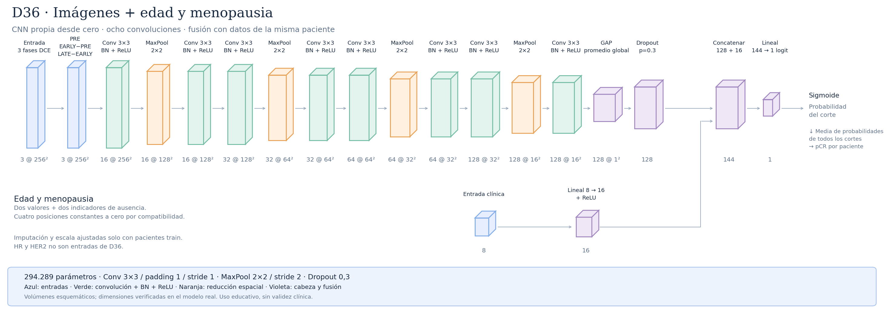

# D36 · Imágenes, edad y menopausia



Mismo extractor propio E19/E58, no ganador definitivo ni pesos reutilizados.
Solo edad y menopausia como variables: no lee HR/HER2 del CSV. Cuatro entradas
informativas: dos valores y dos indicadores de ausencia. Se conservan ocho slots
por compatibilidad y comparación: posiciones1/2/5/6 son ceros constantes.
Esto NO añade cuatro variables clínicas ocultas. Total real: 294289 parámetros;
algunos pesos de entrada multiplican siempre cero, no aportan señal.

Cuatro bloques Conv3×3/BN/ReLU→MaxPool2×2→Conv3×3/BN/ReLU;
canales16/32/64/128, resoluciones256→128→64→32→16, campo local106.
GAP128/dropout0,3; rama clínica8→16/ReLU (144params), fusión144→1 (145params).
Fusión aditiva en logit, no atención ni interacción explícita imagen/clínica.
Edad mediana/escala y menopausia moda ajustadas solo en pacientes train.
Ausencia no equivale a cero observado; sus indicadores permanecen activos.
Los ausentes pueden reflejar cohortes; investigar, no atribuir causalidad.

Inicialización desde cero;50épocas/paciencia10, batch16, LR/WD0,001,
BCE normal por corte. Evaluación principal media de probabilidades por paciente.
Umbral0,5 provisional para comparar; no umbral final ni optimizado en test.
Preparado sin ningún entrenamiento. Comparar controles de imágenes y clínica,
otras semillas y folds antes de atribuir mejora o adoptar modelo.
El profesorado permite estas variables; falta verificar su entrega
en la defensa y su registro basal. La web todavía no integra este checkpoint.

```sh
python -u -m src.training.train_multimodal --config experiments/D36_age_menopause/run/config.json --device mps
```

## Capas reales (batch ficticio1)

| Capa | Tipo | Entrada | Salida | Parámetros | Kernel/padding/stride |
|---|---|---|---|---:|---|
| image_encoder.input_normalizer | TripletStandardization | `(1, 3, 256, 256)` | `(1, 3, 256, 256)` | 0 | — |
| image_encoder.input_transform | PhaseRepresentation | `(1, 3, 256, 256)` | `(1, 3, 256, 256)` | 0 | — |
| image_encoder.blocks.0.features.0 | Conv2d | `(1, 3, 256, 256)` | `(1, 16, 256, 256)` | 432 | k=(3, 3), p=(1, 1), s=(1, 1) |
| image_encoder.blocks.0.features.1 | BatchNorm2d | `(1, 16, 256, 256)` | `(1, 16, 256, 256)` | 32 | — |
| image_encoder.blocks.0.features.2 | ReLU | `(1, 16, 256, 256)` | `(1, 16, 256, 256)` | 0 | — |
| image_encoder.blocks.0.pool | MaxPool2d | `(1, 16, 256, 256)` | `(1, 16, 128, 128)` | 0 | k=2, s=2 |
| image_encoder.blocks.0.features.3 | Conv2d | `(1, 16, 128, 128)` | `(1, 16, 128, 128)` | 2304 | k=(3, 3), p=(1, 1), s=(1, 1) |
| image_encoder.blocks.0.features.4 | BatchNorm2d | `(1, 16, 128, 128)` | `(1, 16, 128, 128)` | 32 | — |
| image_encoder.blocks.0.features.5 | ReLU | `(1, 16, 128, 128)` | `(1, 16, 128, 128)` | 0 | — |
| image_encoder.blocks.1.features.0 | Conv2d | `(1, 16, 128, 128)` | `(1, 32, 128, 128)` | 4608 | k=(3, 3), p=(1, 1), s=(1, 1) |
| image_encoder.blocks.1.features.1 | BatchNorm2d | `(1, 32, 128, 128)` | `(1, 32, 128, 128)` | 64 | — |
| image_encoder.blocks.1.features.2 | ReLU | `(1, 32, 128, 128)` | `(1, 32, 128, 128)` | 0 | — |
| image_encoder.blocks.1.pool | MaxPool2d | `(1, 32, 128, 128)` | `(1, 32, 64, 64)` | 0 | k=2, s=2 |
| image_encoder.blocks.1.features.3 | Conv2d | `(1, 32, 64, 64)` | `(1, 32, 64, 64)` | 9216 | k=(3, 3), p=(1, 1), s=(1, 1) |
| image_encoder.blocks.1.features.4 | BatchNorm2d | `(1, 32, 64, 64)` | `(1, 32, 64, 64)` | 64 | — |
| image_encoder.blocks.1.features.5 | ReLU | `(1, 32, 64, 64)` | `(1, 32, 64, 64)` | 0 | — |
| image_encoder.blocks.2.features.0 | Conv2d | `(1, 32, 64, 64)` | `(1, 64, 64, 64)` | 18432 | k=(3, 3), p=(1, 1), s=(1, 1) |
| image_encoder.blocks.2.features.1 | BatchNorm2d | `(1, 64, 64, 64)` | `(1, 64, 64, 64)` | 128 | — |
| image_encoder.blocks.2.features.2 | ReLU | `(1, 64, 64, 64)` | `(1, 64, 64, 64)` | 0 | — |
| image_encoder.blocks.2.pool | MaxPool2d | `(1, 64, 64, 64)` | `(1, 64, 32, 32)` | 0 | k=2, s=2 |
| image_encoder.blocks.2.features.3 | Conv2d | `(1, 64, 32, 32)` | `(1, 64, 32, 32)` | 36864 | k=(3, 3), p=(1, 1), s=(1, 1) |
| image_encoder.blocks.2.features.4 | BatchNorm2d | `(1, 64, 32, 32)` | `(1, 64, 32, 32)` | 128 | — |
| image_encoder.blocks.2.features.5 | ReLU | `(1, 64, 32, 32)` | `(1, 64, 32, 32)` | 0 | — |
| image_encoder.blocks.3.features.0 | Conv2d | `(1, 64, 32, 32)` | `(1, 128, 32, 32)` | 73728 | k=(3, 3), p=(1, 1), s=(1, 1) |
| image_encoder.blocks.3.features.1 | BatchNorm2d | `(1, 128, 32, 32)` | `(1, 128, 32, 32)` | 256 | — |
| image_encoder.blocks.3.features.2 | ReLU | `(1, 128, 32, 32)` | `(1, 128, 32, 32)` | 0 | — |
| image_encoder.blocks.3.pool | MaxPool2d | `(1, 128, 32, 32)` | `(1, 128, 16, 16)` | 0 | k=2, s=2 |
| image_encoder.blocks.3.features.3 | Conv2d | `(1, 128, 16, 16)` | `(1, 128, 16, 16)` | 147456 | k=(3, 3), p=(1, 1), s=(1, 1) |
| image_encoder.blocks.3.features.4 | BatchNorm2d | `(1, 128, 16, 16)` | `(1, 128, 16, 16)` | 256 | — |
| image_encoder.blocks.3.features.5 | ReLU | `(1, 128, 16, 16)` | `(1, 128, 16, 16)` | 0 | — |
| image_encoder.global_pool | AdaptiveAvgPool2d | `(1, 128, 16, 16)` | `(1, 128, 1, 1)` | 0 | — |
| image_encoder.flatten | Flatten | `(1, 128, 1, 1)` | `(1, 128)` | 0 | — |
| image_encoder.dropout | Dropout | `(1, 128)` | `(1, 128)` | 0 | — |
| clinical_branch.0 | Linear | `(1, 8)` | `(1, 16)` | 144 | — |
| clinical_branch.1 | ReLU | `(1, 16)` | `(1, 16)` | 0 | — |
| fusion | Linear | `(1, 144)` | `(1, 1)` | 145 | — |

Regenerar: `python -m src.reporting.document_architectures --only D36_edad_menopausia`.
Uso educativo y de investigación, sin validez clínica.
