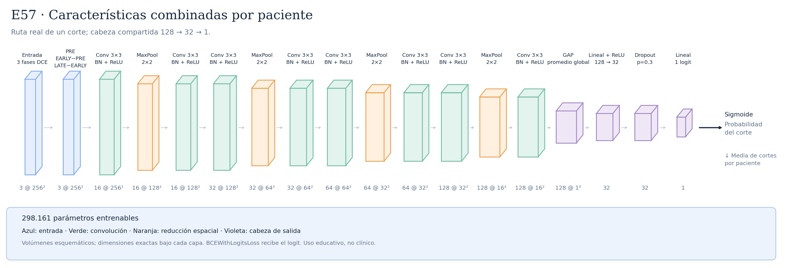

# E57 · carpeta de presentación

Empieza por [RESULTADOS.ipynb](RESULTADOS.ipynb): todo está mostrado sin ejecutar celdas.

[Protocolo de cierre](CIERRE.md).

La carpeta contiene solo este resumen, el notebook, la imagen de la arquitectura y las gráficas. Las fuentes originales permanecen en sus ubicaciones y en los notebooks generales.

E57 es una CNN 2D propia entrenada desde cero, con **298.161 parámetros**. Recibe PRE, EARLY y LATE y construye PRE, EARLY−PRE y LATE−EARLY. Tiene cuatro bloques de canales 16/32/64/128, dos convoluciones por bloque, BatchNorm, ReLU y cuatro reducciones MaxPool. Después usa promedio espacial global y una cabeza 128→32→1 con ReLU y dropout 0,3.

En entrenamiento se agrupan dos pacientes por lote y se promedian las características de todos sus cortes antes de la cabeza. La pérdida es una BCE normal por paciente. En la evaluación principal se predice cada corte y se promedian sus probabilidades por paciente; esta agregación es distinta de promediar características antes de la cabeza.

AdamW: LR inicial 0,001 y weight decay 0,001; ReduceLROnPlateau según AUC paciente, factor 0,5 y paciencia 3. Semilla 42, máximo 50 épocas y parada tras 10 épocas sin mejorar el AUC de validación. No se usan aumentos, pesos preentrenados, edad ni menopausia. El escalado docente de las intensidades se conserva.

Los cinco folds agrupan cortes de la misma paciente. El fold 0 es histórico y los folds 1–4 se ejecutaron después con la misma receta. La época se eligió con el AUC del mismo fold que se reporta: la media **0,6224** de los cinco máximos es descriptiva y optimista, no una evaluación exterior independiente. Un protocolo anterior con selección interna distinta obtuvo AUC exterior media 0,5272.

Las matrices de este dossier usan **umbral 0,325**, solicitado después de observar la validación. El AUC y las probabilidades no cambian por ese umbral. Los resultados se presentan como exploratorios; bajar el corte aumenta tanto las positivas detectadas como las falsas alarmas. Test ya evaluado para el checkpoint original de época 14; ver la sección final de test.

Las tres gráficas por fold reproducen el propósito de la referencia del profesor: pérdida por época, AUC por época y barras de AUC en la misma época elegida. Para el fold 0 falta la serie train-eval completa: se muestran sus pérdidas históricas con la advertencia correspondiente y un único punto train-eval auditado en la época 14. **La barra real de test solo se añade al fold 0, que es el modelo evaluado; los otros cuatro modelos no se evalúan en test.**

## Resumen de los cinco folds

|   Fold |   Épocas |   Mejor época |   AUC paciente |   AP paciente |   Precisión pCR |   Sensibilidad |   Especificidad |     BA |   TN |   FP |   FN |   TP |
|-------:|---------:|--------------:|---------------:|--------------:|----------------:|---------------:|----------------:|-------:|-----:|-----:|-----:|-----:|
|      0 |       24 |            14 |         0.6703 |        0.4225 |          0.439  |         0.5625 |          0.7032 | 0.6329 |  109 |   46 |   28 |   36 |
|      1 |       37 |            27 |         0.6299 |        0.4108 |          0.338  |         0.7742 |          0.4013 | 0.5877 |   63 |   94 |   14 |   48 |
|      2 |       20 |            10 |         0.6688 |        0.4006 |          0.3272 |         0.8983 |          0.323  | 0.6106 |   52 |  109 |    6 |   53 |
|      3 |       12 |             2 |         0.5503 |        0.4161 |          0.5714 |         0.0533 |          0.9793 | 0.5163 |  142 |    3 |   71 |    4 |
|      4 |       15 |             5 |         0.5927 |        0.3977 |          0.29   |         0.9355 |          0.0955 | 0.5155 |   15 |  142 |    4 |   58 |

Uso educativo, sin validez clínica.

**TEST final ya evaluado para el checkpoint original:** [TEST.md](TEST.md) · [TEST.ipynb](TEST.ipynb). Las referencias a test pendiente en la descripción histórica corresponden a la fase previa al cierre.
