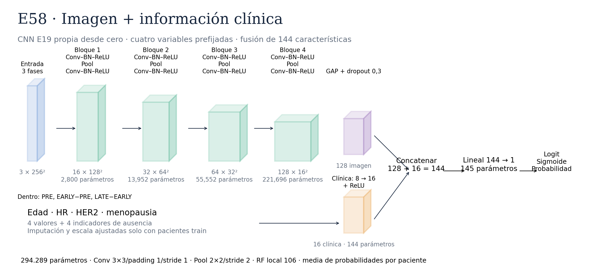

# E58 · CNN E19 + clínica



Hipótesis: edad, HR, HER2 y menopausia aportan información complementaria a DCE-MRI.
No se garantiza mejora ni 0,7. E19 es la referencia provisional, no un ganador estable.
Toda la red se inicializa desde cero; no se cargan pesos E19 ni pesos externos.

## Ramas y fusión

Extractor E19: 8 convoluciones 3×3, 8 BN/ReLU, 4 MaxPool entre convoluciones;
16/32/64/128 canales; 256→128→64→32→16; campo receptivo local 106.
GAP produce 128 características y dropout 0,3. Clínica: 8→16/ReLU.
Concatenación 144→1: fusión **aditiva en el logit**, no atención ni interacción
explícita entre modalidades. Total comprobado: **294289 parámetros**.

Edad: mediana para ausentes y estandarización; binarias: moda para ausentes.
Cuatro indicadores preservan la ausencia. Estadísticas con una fila por paciente
del train interno únicamente, guardadas con el checkpoint para reutilizar en inferencia.
IDs solo para unir registros; pCR, cohorte, split y subtipos redundantes no son entradas.
Los indicadores de ausencia podrían reflejar cohortes, no interpretarlos causalmente.

## Protocolo y resultados

Fold 0/semilla 42; 878 pacientes train y 219 validación, sin test.
Batch 16, AdamW LR/WD 0,001, BCE por corte, máximo 50 épocas,
Plateau paciencia 3/factor 0,5 y early stopping paciencia 10.
Métrica principal: ROC-AUC **por paciente**, media de probabilidades de cortes.
No aumenta pacientes ni aplica rotaciones; cambia únicamente la modalidad clínica
respecto a la referencia, con nueva cabeza y trayectoria aleatoria propia.
E58 completado por el estudiante: AUC0,747076613/AP0,544753123, best2 de12.
A0,5 sensibilidad0,15625 y F10,23529: AUC alto no garantiza decisiones satisfactorias.
[Nueva etapa clínica y figuras](../README.md).
Smoke técnico no demuestra calidad; no reentrenar E58 para organizar archivos.

```sh
python -u -m src.training.train_multimodal --config configs/multimodal/E58_clinical_fusion_mac.json --device mps
```

Resultados locales: `reports/multimodal/E58_clinical_fusion_mac/fold_0_seed_42/`:
summary.json, history.csv, training_curves.png, evaluation_patient.png,
predictions_cut/patient.csv, auditoría clínica y preprocesador. Pesos en checkpoints.
No sobrescribe una ejecución existente. La web actual no acepta este checkpoint:
requiere rama clínica y mismo preprocesador. Confirmar que el profesor facilitará
estas variables en la demo y que son basales, disponibles antes del tratamiento.
Para atribuir el aporte de imagen posteriormente comparar con clínica sola.

## Capas reales (batch ficticio 1)

| Capa | Tipo | Entrada | Salida | Parámetros | Kernel/padding/stride |
|---|---|---|---|---:|---|
| image_encoder.input_normalizer | TripletStandardization | `(1, 3, 256, 256)` | `(1, 3, 256, 256)` | 0 | — |
| image_encoder.input_transform | PhaseRepresentation | `(1, 3, 256, 256)` | `(1, 3, 256, 256)` | 0 | — |
| image_encoder.blocks.0.features.0 | Conv2d | `(1, 3, 256, 256)` | `(1, 16, 256, 256)` | 432 | k=(3, 3), p=(1, 1), s=(1, 1) |
| image_encoder.blocks.0.features.1 | BatchNorm2d | `(1, 16, 256, 256)` | `(1, 16, 256, 256)` | 32 | — |
| image_encoder.blocks.0.features.2 | ReLU | `(1, 16, 256, 256)` | `(1, 16, 256, 256)` | 0 | — |
| image_encoder.blocks.0.pool | MaxPool2d | `(1, 16, 256, 256)` | `(1, 16, 128, 128)` | 0 | k=2, s=2 |
| image_encoder.blocks.0.features.3 | Conv2d | `(1, 16, 128, 128)` | `(1, 16, 128, 128)` | 2304 | k=(3, 3), p=(1, 1), s=(1, 1) |
| image_encoder.blocks.0.features.4 | BatchNorm2d | `(1, 16, 128, 128)` | `(1, 16, 128, 128)` | 32 | — |
| image_encoder.blocks.0.features.5 | ReLU | `(1, 16, 128, 128)` | `(1, 16, 128, 128)` | 0 | — |
| image_encoder.blocks.1.features.0 | Conv2d | `(1, 16, 128, 128)` | `(1, 32, 128, 128)` | 4608 | k=(3, 3), p=(1, 1), s=(1, 1) |
| image_encoder.blocks.1.features.1 | BatchNorm2d | `(1, 32, 128, 128)` | `(1, 32, 128, 128)` | 64 | — |
| image_encoder.blocks.1.features.2 | ReLU | `(1, 32, 128, 128)` | `(1, 32, 128, 128)` | 0 | — |
| image_encoder.blocks.1.pool | MaxPool2d | `(1, 32, 128, 128)` | `(1, 32, 64, 64)` | 0 | k=2, s=2 |
| image_encoder.blocks.1.features.3 | Conv2d | `(1, 32, 64, 64)` | `(1, 32, 64, 64)` | 9216 | k=(3, 3), p=(1, 1), s=(1, 1) |
| image_encoder.blocks.1.features.4 | BatchNorm2d | `(1, 32, 64, 64)` | `(1, 32, 64, 64)` | 64 | — |
| image_encoder.blocks.1.features.5 | ReLU | `(1, 32, 64, 64)` | `(1, 32, 64, 64)` | 0 | — |
| image_encoder.blocks.2.features.0 | Conv2d | `(1, 32, 64, 64)` | `(1, 64, 64, 64)` | 18432 | k=(3, 3), p=(1, 1), s=(1, 1) |
| image_encoder.blocks.2.features.1 | BatchNorm2d | `(1, 64, 64, 64)` | `(1, 64, 64, 64)` | 128 | — |
| image_encoder.blocks.2.features.2 | ReLU | `(1, 64, 64, 64)` | `(1, 64, 64, 64)` | 0 | — |
| image_encoder.blocks.2.pool | MaxPool2d | `(1, 64, 64, 64)` | `(1, 64, 32, 32)` | 0 | k=2, s=2 |
| image_encoder.blocks.2.features.3 | Conv2d | `(1, 64, 32, 32)` | `(1, 64, 32, 32)` | 36864 | k=(3, 3), p=(1, 1), s=(1, 1) |
| image_encoder.blocks.2.features.4 | BatchNorm2d | `(1, 64, 32, 32)` | `(1, 64, 32, 32)` | 128 | — |
| image_encoder.blocks.2.features.5 | ReLU | `(1, 64, 32, 32)` | `(1, 64, 32, 32)` | 0 | — |
| image_encoder.blocks.3.features.0 | Conv2d | `(1, 64, 32, 32)` | `(1, 128, 32, 32)` | 73728 | k=(3, 3), p=(1, 1), s=(1, 1) |
| image_encoder.blocks.3.features.1 | BatchNorm2d | `(1, 128, 32, 32)` | `(1, 128, 32, 32)` | 256 | — |
| image_encoder.blocks.3.features.2 | ReLU | `(1, 128, 32, 32)` | `(1, 128, 32, 32)` | 0 | — |
| image_encoder.blocks.3.pool | MaxPool2d | `(1, 128, 32, 32)` | `(1, 128, 16, 16)` | 0 | k=2, s=2 |
| image_encoder.blocks.3.features.3 | Conv2d | `(1, 128, 16, 16)` | `(1, 128, 16, 16)` | 147456 | k=(3, 3), p=(1, 1), s=(1, 1) |
| image_encoder.blocks.3.features.4 | BatchNorm2d | `(1, 128, 16, 16)` | `(1, 128, 16, 16)` | 256 | — |
| image_encoder.blocks.3.features.5 | ReLU | `(1, 128, 16, 16)` | `(1, 128, 16, 16)` | 0 | — |
| image_encoder.global_pool | AdaptiveAvgPool2d | `(1, 128, 16, 16)` | `(1, 128, 1, 1)` | 0 | — |
| image_encoder.flatten | Flatten | `(1, 128, 1, 1)` | `(1, 128)` | 0 | — |
| image_encoder.dropout | Dropout | `(1, 128)` | `(1, 128)` | 0 | — |
| clinical_branch.0 | Linear | `(1, 8)` | `(1, 16)` | 144 | — |
| clinical_branch.1 | ReLU | `(1, 16)` | `(1, 16)` | 0 | — |
| fusion | Linear | `(1, 144)` | `(1, 1)` | 145 | — |

Diagrama y tabla regenerables con `python -m src.reporting.document_multimodal`.
Uso educativo y de investigación, sin validez clínica.
